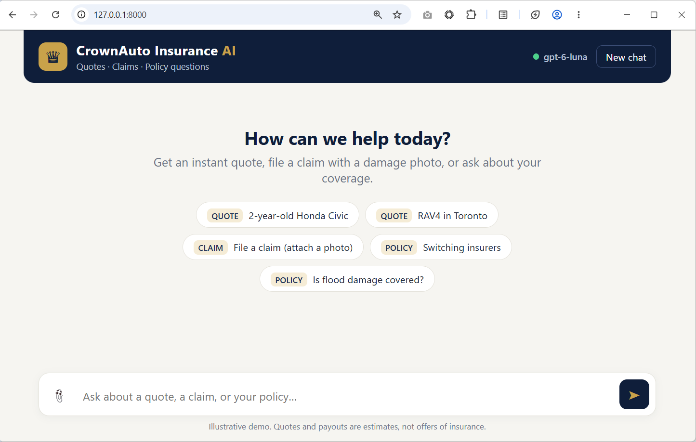
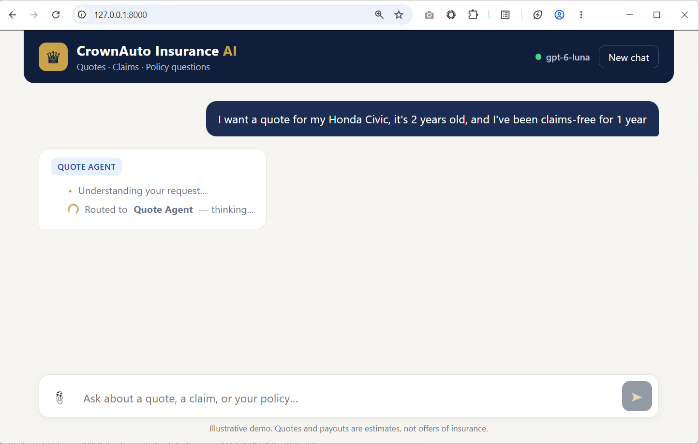
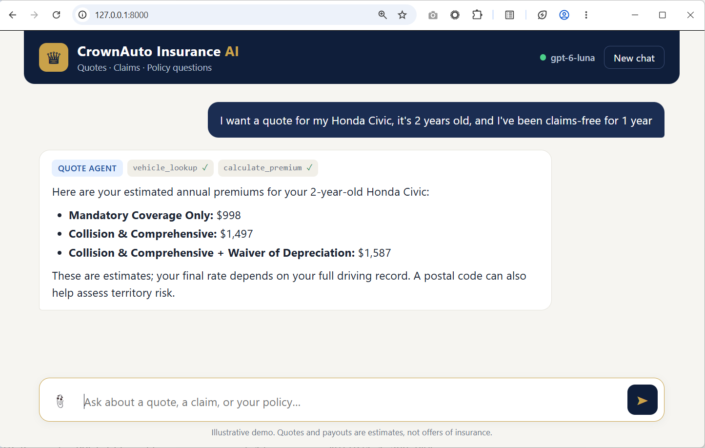
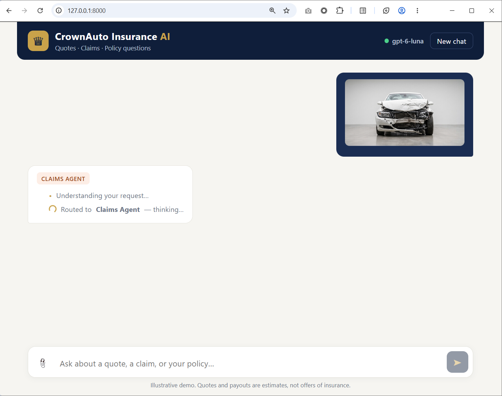
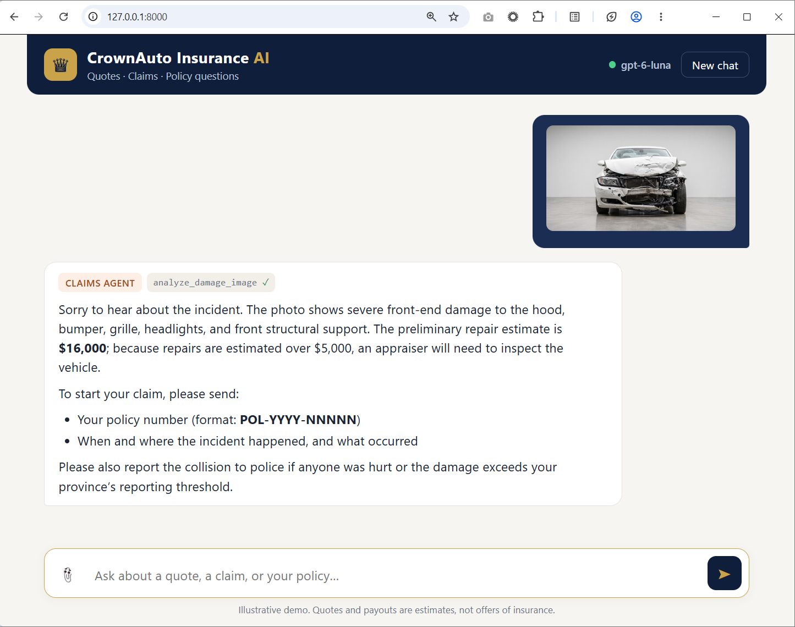
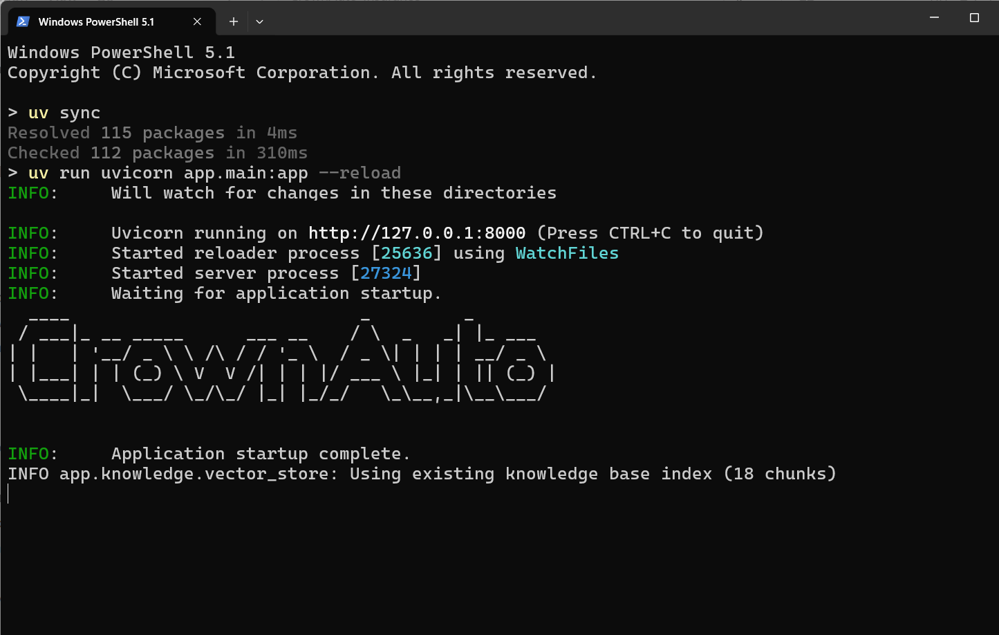
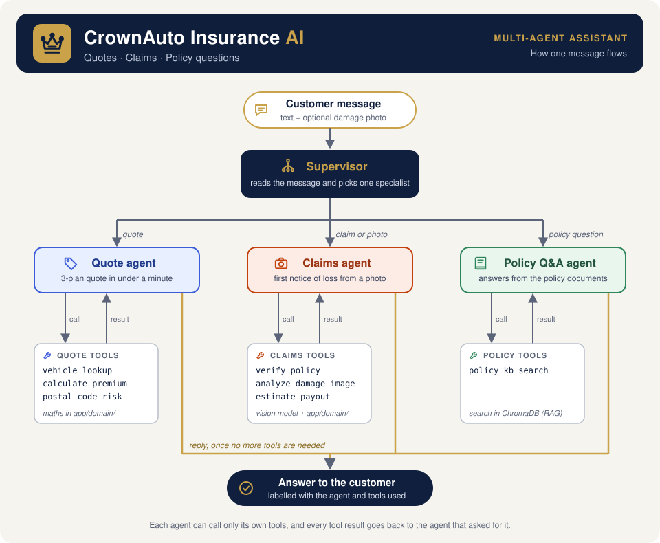

# CrownAuto Insurance AI — Multi-Agent Car Insurance Assistant

**Instant car insurance quotes, photo-based claims and policy answers in one 24/7 chat. Routine requests that take days today get handled in minutes, and complex cases still go to people.**

A chat assistant for a Canadian auto insurer. It runs locally: Python with FastAPI and LangGraph on the back end, and a browser chat UI on the front end.

## Contents

- [Business case study](#business-case-study)
- [Overview](#overview)
- [Key features](#key-features)
- [See it working](#see-it-working)
- [Tech stack](#tech-stack)
- [Prerequisites](#prerequisites)
- [Quick start](#quick-start-windows--macos--linux)
- [Tests](#tests)
- [Cost](#cost)
- [Architecture](#architecture)
- [API](#api)
- [Rating model](#rating-model)
- [Behaviour](#behaviour)
- [Hardening backlog](#hardening-backlog)

## Business case study

> CrownAuto Insurance is a fictional company. The operating figures below are illustrative assumptions for a mid-sized Canadian insurer, not real data.

### Situation

CrownAuto insures about **200,000 policyholders** across Canada. Its service team handles thousands of interactions a day, almost all of them one of three types:

| Type | Examples | Today |
|---|---|---|
| **Quote requests** | "How much to insure my Honda Civic?" | A long form, then a callback. **24–48 hours**, and many prospects go to a competitor. |
| **Claims** | "I hit a guardrail on the highway." | Body shop visit, appraiser, paperwork. **7–14 days.** |
| **Policy questions** | "Is flood damage covered?" | Every call needs a trained agent. **22-minute average queue.** |

Agents spend **6–8 hours a day** on this work, most of which follows predictable steps. Each interaction costs about **$8**.

### Task

Build a working prototype of an AI assistant that:

1. **Handles routine quotes, claims and policy questions in one chat conversation**, around the clock.
2. **Gets the money right every time**, using CrownAuto's own rating and claim rules rather than figures made up by an AI model.
3. **Answers from CrownAuto's policy documents** and says when they don't cover a question.
4. **Hands complex cases to people**: large repairs, total losses and fraud concerns.
5. **Shows its work**, so staff can audit and trust each answer.

### Action

- **One supervisor, three specialists.** A supervisor agent (built with LangGraph) routes each message to a **Quote**, **Claims** or **Policy Q&A** agent. Each one has a focused prompt and only the tools for its own job.
- **Calculations live in code, not in the AI model.** Premiums, Actual Cash Value (ACV), deductibles, total-loss rules and payouts are tested Python functions. The model decides *when* to call them; the code produces the numbers.
- **Instant quotes.** The Quote agent asks for three or four details and returns three plans side by side. It explains when an option isn't available.
- **Photo-based claims.** A vision model estimates the damage and repair cost from the customer's photo. The Claims agent then verifies the policy and calculates the payout and the customer's out-of-pocket cost.
- **Answers from the documents.** Policy wording, provincial guidelines and FAQs are indexed in a vector database (ChromaDB). The Policy Q&A agent answers from what it finds and cites the source.
- **Built-in escalation.** Repairs over $5,000 trigger an appraiser inspection, and likely total losses are flagged.
- **Transparent and extensible.** The chat UI streams each step and labels every answer with the agent and tools used. The code is split into layers and tested, so the mock policy database and vehicle catalogue can be replaced with real systems without changing the agents.

### Result

**What the prototype delivers today**

- A quote, a first notice of loss (FNOL) with a damage estimate, or an answer from the policy documents, **in one chat conversation**.
- **Repeatable pricing.** For example, a 2-year-old Honda Civic with one claim-free year is always quoted at **$998 / $1,497 / $1,587** for the three plans.
- **50 automated tests** covering the business rules, the multi-turn agent flow and the API, all running without an API key.

**Projected business impact (targets to confirm in a pilot)**

| Metric | Today | Target |
|---|---|---|
| Routine interactions handled without an agent | 0% | **70–80%** |
| Quote turnaround | 24–48 hours | **Under 1 minute** |
| Claim intake to payout estimate | 7–14 days | **Minutes** (complex cases still go to an adjuster) |
| Policy question wait | 22 minutes | **Seconds** |
| Cost per routine interaction | ~$8 | **Under $0.10** in model costs |

This frees the service team to focus on complex claims, fraud investigation and key customer relationships.

### Lessons learned and next steps

- **Narrow agents beat one big agent.** Giving each specialist only its own tools made its behaviour easier to predict and debug.
- **Keep money out of the model.** Rules in tested code give consistent quotes and payouts that compliance staff can review.
- **Follow-ups need context.** A reply like "POL-2026-12345" only makes sense with the previous turn, so the supervisor considers which agent handled it.
- **Before production:** connect the real rating engine and policy database, store conversations durably, add identity checks, track each answer and its cost, and run a pilot to measure the targets above.

---

## Overview

A LangGraph **supervisor** sends each message to one of three specialist agents:

| Agent | Tools | Does |
|---|---|---|
| **Quote** | `vehicle_lookup`, `calculate_premium`, `postal_code_risk` | Gives an instant 3-plan quote (Canadian rating model) |
| **Claims** | `verify_policy`, `analyze_damage_image` (vision), `estimate_payout` | Takes the first notice of loss (FNOL): checks the policy, reads the photo, estimates the payout |
| **Policy Q&A** | `policy_kb_search` (RAG over ChromaDB) | Answers from the policy and provincial-rule documents, citing the source |

The browser UI streams each step live (routing, then each tool call, then the reply). It also shows which agent answered and which tools ran, lets you attach a damage photo, and has starter prompts.

| Metric | Value | Why |
|---|---|---|
| **Difficulty** | Intermediate (3/5) | No hard algorithms. The challenge is wiring a supervisor, three agents, seven tools, RAG and a vision model so that routing, follow-ups and tool results stay in the right place. |
| **Depth** | Moderate (3/5) | Handles input validation, follow-up routing, unavailable plans, total losses, a step limit and recovery from a failed tool call. The 50 tests cover the pricing and payout rules, validation, tool errors and history clean-up. No retries or partial-failure handling around the model calls. |
| **Maturity** | Prototype | Runs on your machine with 50 automated tests, but there's no reproducible deploy, scoped access, CI or observability (see [Hardening backlog](#hardening-backlog)). |
| **Scope** | 1 app · 4 agents · 7 tools · 4 endpoints · ~1.7k lines Python + ~0.5k front end · 0 infrastructure | A local multi-agent application, not a cloud deployment. Also ~0.4k lines of tests. |
| **Cost & build time** | <$0.10 per interaction (target) · ~1 min to set up | Almost all of the cost is OpenAI inference (see [Cost](#cost)). Setup is a fresh `uv sync` (41 s with an empty cache) plus starting the server. The cost per interaction hasn't been measured yet. |
| **Data sensitivity** | Mock data only | A real deployment would handle policyholder details and send claim photos to OpenAI, so it would need consent, retention and privacy review. |

Scored with [`docs/project-metrics.md`](docs/project-metrics.md).

## Key features

- **One chat for three jobs.** Quotes, claims and policy questions all go through the same conversation, and a supervisor agent sends each message to the right specialist.
- **Quotes in under a minute.** The customer gives three or four details and gets three plans side by side, with a clear reason when an option isn't available.
- **Claims from a photo.** A vision model estimates the damage and repair cost, and the policy is checked before the payout and out-of-pocket cost are worked out.
- **Prices and payouts calculated in code.** Tested Python rules produce every premium, deductible and payout, so the same inputs always give the same figures.
- **Answers from the policy documents.** Policy questions are answered from CrownAuto's own wording, with the source cited, and the assistant says when the documents don't cover a question.
- **People handle the hard cases.** Repairs over $5,000 are sent to an appraiser, and likely total losses (repair above 75% of the car's value) are flagged.
- **Every step is visible.** The chat shows each routing decision and tool call as it happens, and labels each answer with the agent and tools used.
- **Tested without an API key.** 50 automated tests cover the business rules, multi-turn conversations and the API.

## See it working

Captured from the app running locally.

| | |
|---|---|
| <br>**1. Start screen:** one chat for quotes, claims and policy questions, with starter prompts. | <br>**2. Routing, live:** the supervisor sends the quote request to the Quote agent, and each step streams in. |
| <br>**3. Instant quote:** a 2-year-old Honda Civic gets three plans ($998 / $1,497 / $1,587). The badges show the tools that ran. | <br>**4. Photo claim:** a damage photo goes straight to the Claims agent. |
| <br>**5. Damage assessed:** the photo is read, repairs are estimated at $16,000, and because that's over $5,000 an appraiser inspection is required. | |

## Tech stack

| Layer | Technology | Role |
|---|---|---|
| Agents | LangGraph, LangChain Core | Supervisor routing, specialist agents, tool calling, per-session memory |
| Models | OpenAI (`gpt-6-luna` by default) | Routing, agent replies and damage-photo analysis (vision) |
| Knowledge base | ChromaDB + `text-embedding-3-small` | Stores and searches the policy documents (RAG) |
| Business rules | Plain Python (`app/domain/`) | Premiums, ACV, deductibles, total-loss and payout rules |
| API | FastAPI, Uvicorn | Chat endpoints, photo upload, Server-Sent Events streaming |
| Front end | HTML, CSS, vanilla JavaScript | Chat UI with live step badges, no build step |
| Config | pydantic-settings, `.env` | Model names, reasoning effort, limits |
| Tooling | uv, pytest | Python 3.12 environment, offline test suite |

## Prerequisites

| | |
|---|---|
| [uv](https://docs.astral.sh/uv/) | any recent version |
| Python | 3.12, pinned in `.python-version`. uv installs it if it's missing. 3.14 isn't supported yet by chromadb's dependencies. |
| OpenAI API key | with access to a chat model that supports tool calling and images (`gpt-6-luna` by default) |
| Disk space | about 350 MB for the virtual environment |
| A web browser | for the chat UI at http://127.0.0.1:8000 |

No API key is needed to run the tests.

## Quick start (Windows / macOS / Linux)

```bash
uv sync                       # creates .venv with Python 3.12 + deps
cp .env.example .env          # then put your OPENAI_API_KEY in .env
uv run uvicorn app.main:app --reload
```

When the server is ready, it prints the CrownAuto banner and "Application startup complete":

<p align="center"></p>

Open http://127.0.0.1:8000.

The first policy question embeds the knowledge base into `data/chroma/`. This takes about a second and costs a fraction of a cent. After that the index is reused, and it is rebuilt automatically if `app/knowledge/documents.py` changes.

### Using a different model

The model names come from `.env`. With a non-reasoning model such as `gpt-4o-mini`, set the three `*_REASONING_EFFORT` values to empty:

```ini
CHAT_MODEL=gpt-4o-mini
VISION_MODEL=gpt-4o-mini
ROUTER_REASONING_EFFORT=
VISION_REASONING_EFFORT=
AGENT_REASONING_EFFORT=
```

## Tests

```bash
uv run pytest
```

All tests run offline with no API key, and they never call OpenAI even if your `.env` has a key. A scripted `FakeChatModel` in `tests/conftest.py` stands in for the LLM.

| Folder | What it tests |
|---|---|
| `tests/unit/` | Business rules (the reference $998 / $1,497 / $1,587 Civic quote, payouts, ACV), the tool executor, routing, chunking |
| `tests/integration/` | Full multi-turn conversations through the real graph: quote, then photo claim, then policy question |
| `tests/api/` | HTTP endpoints through FastAPI's `TestClient`: validation, JSON reply, SSE stream |

## Cost

Running it locally costs only OpenAI API usage:

- **Policy knowledge base:** embedding the documents happens once, on the first policy question, and costs a fraction of a cent. The index is then reused.
- **Each chat turn:** one routing call plus one or more agent calls, and a vision call when a photo is analysed. The target is **under $0.10 per routine interaction** in model costs, compared with about $8 for a staffed interaction today. This hasn't been measured yet (see the [Hardening backlog](#hardening-backlog)).
- **Tests:** free. They never call OpenAI.

To spend less, switch `CHAT_MODEL` and `VISION_MODEL` to a smaller model in `.env` (see [Using a different model](#using-a-different-model)).

## Architecture

The code is split into **layers**. Each layer only imports from the layers *below* it, never above. So business rules don't know about LLMs, and agents don't know about HTTP.

```
 ┌───────────────────────────────────────────────────────────────┐
 │ api/        HTTP: routes, request/response schemas, uploads   │  ← FastAPI lives only here
 ├───────────────────────────────────────────────────────────────┤
 │ services/   Use cases: "run one chat turn", "reset a chat"    │
 ├───────────────────────────────────────────────────────────────┤
 │ workflow/   LangGraph: wires agents + tools into a graph      │
 ├───────────────────────────────────────────────────────────────┤
 │ agents/     Supervisor + 3 specialists, their prompts, state  │
 ├───────────────────────────────────────────────────────────────┤
 │ tools/      Functions the LLM may call (@tool wrappers)       │
 ├──────────────────────────────┬────────────────────────────────┤
 │ knowledge/  KB docs + Chroma │ llm/  model factory, JSON parse│
 ├──────────────────────────────┴────────────────────────────────┤
 │ domain/     Pure business rules — no frameworks, no I/O       │  ← easiest to test
 ├───────────────────────────────────────────────────────────────┤
 │ core/       Settings (.env)                                   │
 └───────────────────────────────────────────────────────────────┘
```

### Project layout

```
app/
├── main.py                  create_app(): builds ChatService at startup, adds routers, serves UI
├── core/config.py           Settings class (pydantic-settings) + get_settings()
├── domain/                  Pure Python business rules
│   ├── pricing.py           ACV, mandatory premium, calculate_premium, get_three_quotes
│   ├── vehicles.py          Vehicle catalogue + fuzzy lookup
│   ├── territory.py         Postal-code risk tiers
│   └── claims.py            verify_policy, estimate_payout
├── llm/
│   ├── factory.py           get_chat_model("router" | "agent" | "vision"), get_embeddings()
│   └── parsing.py           parse_json_response() — strips ```json fences
├── knowledge/
│   ├── documents.py         The 3 policy documents
│   └── vector_store.py      PolicyVectorStore: chunk → embed → store → search
├── tools/
│   ├── quote_tools.py       vehicle_lookup, calculate_premium, postal_code_risk
│   ├── claims_tools.py      verify_policy, analyze_damage_image (vision), estimate_payout
│   ├── policy_tools.py      policy_kb_search (RAG)
│   └── __init__.py          Tool lists per agent + TOOL_REGISTRY
├── agents/
│   ├── state.py             AgentState (the shared conversation state)
│   ├── prompts.py           Every system prompt in one place
│   ├── supervisor.py        Intent router
│   └── specialists.py       Quote / Claims / Policy Q&A agent nodes
├── workflow/
│   ├── tool_executor.py     Runs requested tools (injects the uploaded photo)
│   └── graph.py             build_graph(): nodes + edges + checkpointer
├── services/
│   └── chat_service.py      ChatService.stream() / send() / reset()
└── api/
    ├── routes/chat.py       POST /api/chat, POST /api/chat/stream, DELETE /api/session/{id}
    ├── routes/health.py     GET /api/health
    ├── forms.py             Validates the chat form + photo upload
    ├── schemas.py           Request/response models
    └── dependencies.py      get_chat_service() for Depends(...)
static/                      Chat UI: index.html, styles.css, app.js (no build step)
tests/                       unit/, integration/, api/ + conftest.py (FakeChatModel)
docs/                        agent-flow.svg, screenshots/, project-metrics.md (scoring rubric)
```

### How one message flows through the code

<p align="center"></p>

1. **`static/app.js`** posts the form (text + optional photo) to `POST /api/chat/stream`.
2. **`api/forms.py`** validates the input: message not empty, image type and size OK. It turns the photo into a data URL.
3. **`api/routes/chat.py`** gets the `ChatService` through `Depends(get_chat_service)` and calls `service.stream(...)`.
4. **`services/chat_service.py`** runs the graph for that `session_id` and converts each finished node into a small event (`route`, `tool_call`, `tool_result`, `final`).
5. **`workflow/graph.py`** runs the nodes shown in the diagram above: `supervisor` → `quote` / `claims` / `policy_qa` → `tools` → back to the same agent, until the agent replies without calling a tool.
6. **`agents/supervisor.py`** picks the specialist. The **agent** in `agents/specialists.py` calls the LLM, which either replies or asks for tools.
7. **`workflow/tool_executor.py`** runs the requested tools from `tools/`. These call `domain/` for the maths, or `knowledge/` for RAG. The agent then sees the results.
8. The events stream back to the browser over SSE, and the UI draws the badges and the reply.

### Where do I change…?

| I want to… | Edit |
|---|---|
| Change premium rates, discounts or payout rules | `app/domain/pricing.py`, `app/domain/claims.py` |
| Add a vehicle | `VEHICLE_CATALOG` in `app/domain/vehicles.py` |
| Change how an agent behaves or talks | `app/agents/prompts.py` |
| Add or edit policy documents for RAG | `app/knowledge/documents.py` (the index rebuilds automatically) |
| Add a new tool | Write it in the matching `app/tools/*_tools.py` and add it to that file's tool list |
| Add a new specialist agent | Prompt in `prompts.py`, node in `specialists.py`, an intent in `state.py` (`INTENT_TO_AGENT`), register it in `AGENT_NODES` in `workflow/graph.py`, and describe it in `SUPERVISOR_PROMPT` |
| Switch models or reasoning effort | `.env` (see `app/core/config.py` for all settings) |
| Save chats across restarts | Pass a SQLite or Postgres checkpointer to `build_graph()` in `app/main.py` |
| Add an endpoint | A new router in `app/api/routes/`, included in `create_app()` |

### Design choices

- **Business rules have no dependencies.** `domain/` is plain Python, so the money maths is unit-tested without LLMs or a server.
- **Dependency injection.** `ChatService` receives its graph as a parameter instead of creating one, and routes receive the service through `Depends`. Tests can swap either one easily.
- **One place for each concern.** Model clients are only created in `llm/factory.py`, prompts only live in `agents/prompts.py`, and settings only come from `core/config.py`.
- **Thin routes.** Routes validate, call a service and return. The logic lives in services and below.

## API

| Method | Path | Body | Returns |
|---|---|---|---|
| `GET` | `/api/health` | — | Server status, whether a key is set, model names |
| `POST` | `/api/chat/stream` | form: `message`, `session_id`, optional `image` | Server-Sent Events: `route`, `tool_call`, `tool_result`, `final` / `error` |
| `POST` | `/api/chat` | same | JSON `{reply, intent, agent, tools_used}` |
| `DELETE` | `/api/session/{id}` | — | Deletes that conversation's saved state |

Example:

```bash
curl -N -X POST localhost:8000/api/chat/stream -F session_id=demo -F message="Is flood damage covered?"
curl -X POST localhost:8000/api/chat -F session_id=demo2 -F message="I had an accident, policy POL-2026-12345" -F image=@damage.jpg
```

## Rating model

All figures are in CAD. The model is defined in `app/domain/pricing.py` and `app/domain/claims.py`.

```
ACV                = MSRP × (1 − depreciation by age: 10% … 53%, 60% after 5 years)
Mandatory premium  = $1,050 car / $1,150 SUV / $1,300 pickup
Physical damage    = ACV × 2.5%            (Collision & Comprehensive plans)
Claims-free disc.  = (Mandatory + Physical damage) × 5% per claim-free year, max 25%
Waiver of Dep.     = flat $90 / year       (cars up to 2 years old)
Total              = Mandatory + Physical damage − discount + Waiver   (no GST/HST)
```

Every quote shows three plans: **Mandatory Coverage Only**, **+ Collision & Comprehensive**, and **+ Waiver of Depreciation**.

For claims, a repair pays the repair cost minus the deductible. If the repair costs more than 75% of ACV, the car is a total loss and is paid at ACV minus the deductible (or the purchase price, with Waiver of Depreciation). Repairs over $5,000 need an appraiser inspection.

## Behaviour

- **Photo routing:** a photo uploaded with a message always goes to the Claims agent. The photo stays in the conversation, so Claims can analyse it on a later turn, but later messages are routed normally.
- **Follow-ups stay with the same agent:** the supervisor sees which agent handled the last turn and its last reply. Short answers like a policy number or "which plan is best?" stay with that agent.
- **Safety limits:** each turn has a step limit (`GRAPH_RECURSION_LIMIT`). The message history is cleaned before each LLM call, so a failed tool call can't break the rest of the conversation.
- **Images stay out of the prompt:** the Claims agent passes a placeholder, and the tool executor swaps in the uploaded photo. Image bytes never enter the chat history or the UI events.

## Hardening backlog

This is a working prototype, not a production system. These are the known gaps to close before a pilot:

| Gap | Why it matters |
|---|---|
| Conversations are kept in memory (`MemorySaver`) | A server restart loses every open chat. For durable sessions, pass `langgraph-checkpoint-sqlite` or `PostgresSaver` to `build_graph()` in `app/main.py`. |
| Policy verification is mocked | Any `POL-YYYY-NNNNN` number returns an active policy with ACV $28,000 and a $500 deductible, so claims aren't checked against real customers. |
| Rates and payout rules are illustrative | Quotes and payouts follow a simplified model, not CrownAuto's filed rating engine. |
| Vehicle catalogue is hard-coded | Only vehicles in `VEHICLE_CATALOG` can be quoted. It needs a real vehicle data source. |
| No customer identity checks | Anyone with a policy number can start a claim on it. |
| No authentication or rate limiting on the API | The endpoints are open, so anyone who can reach the server can use it and run up model costs. |
| Photo damage estimates aren't validated | The vision model's repair estimate hasn't been compared against real appraiser figures. |
| No per-answer tracing or cost tracking | Staff can see the steps in the UI, but nothing is stored for audit, quality review or spend monitoring. |
| Business targets aren't measured yet | The 70–80% automation and cost figures are projections that need a pilot to confirm. |
| No CI pipeline or container image | Tests run only locally, and there's no standard way to deploy. |
